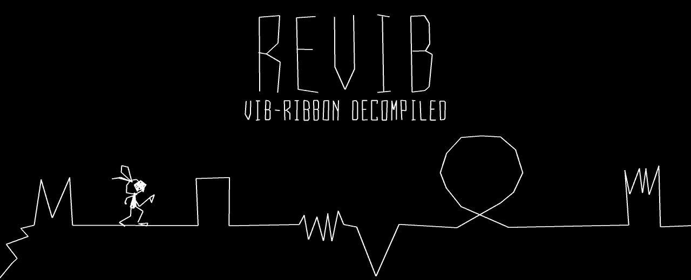
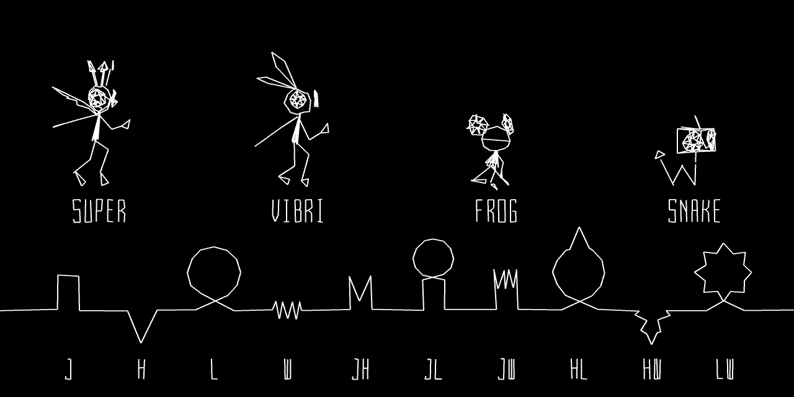

<p align="center"></p>

# revib

**Vib-Ribbon** (PlayStation, PAL, SCES-02873) decompiled to C++.

All four executables of the game are rebuilt from this source and are
**byte-identical** to the ones on the disc:

| Executable    | What it is                         |
|---------------|------------------------------------|
| `SCES_028.73` | the loader                         |
| `MAIN_T.EXE`  | the title: menus, options, results |
| `MAIN_K.EXE`  | the kiosk (demo) version           |
| `MAIN_G.EXE`  | the game itself                    |

The game was written in C++ and compiled with GCC. This source is C++ too:
real classes with named members, the SGI STL 3.2 the game used, and the
original split into source files. It is built with egcs 2.91.66 (egcs
1.1.2), with one change to its C++ compiler where the game's compiler
behaved like GCC 2.95 (see [bin/README.md](bin/README.md)).

## Status

- The game's own code is C++, apart from five functions that still come
  from assembly: `Effect::operator=`, `Gameplay::Update`,
  `Gameplay::AddEvent`, `Glue::Update` and the static initializer of
  `NumberVoice.cpp`. Their C++ is next to them (under `NON_MATCHING`), with
  what still differs written down.
- Sony's PSY-Q libraries (graphics, sound, CD, ...) stay as assembly.
- A few unused strings and data blocks (debug text from headers the game
  never calls, for example) are taken from the original executables as data.

## The debug menus

The game still has its developers' debug menus, and nothing in it opens
them. The `debug-menu` branch adds a way in (select on the first
controller) and describes the menus in its `docs/debug_menus.md`.

## Building

You need your own copy of the game: this repository has none of its files.

Requirements: Linux or WSL 2 (tested on Ubuntu 24.04), `make`,
`binutils-mips-linux-gnu`, Python 3 and `python3-venv`. The compiler is in
`bin/` (see [bin/README.md](bin/README.md)).

```sh
git clone --recursive https://github.com/PawiX25/revib.git
cd revib
python3 -m venv .venv
. .venv/bin/activate
pip install -r tools/requirements.txt

# SCES_028.73, MAIN_T.EXE, MAIN_K.EXE and MAIN_G.EXE go into iso/: copy them
# from your disc, or take them out of an image of its data track with
python3 tools/mod/psxdisc.py extract "Track 1.bin" iso "*.EXE" SCES_028.73

make extract kiosk-extract game-extract loader-extract
make
make kiosk kiosk-check
make game game-check
make loader loader-check
```

`make` builds the title and checks it; each check prints `OK` when the
SHA-1 of the built executable is the original's (kept in the `.sha` files).

To compare a function of a build with the original, use asm-differ, e.g.
`python3 tools/asm-differ/diff.py --exe game Draw__10ModelMovie` (see
`diff_settings.py`).

## Modding tools

`tools/mod/` has small Python tools for the game's data, written from what
the decompiled code reads:

- `psxdisc.py`: list and extract the files of a disc image's data track, and
  write a file of the same size back into the image, recomputing each
  sector's EDC/ECC as a real disc has them.
- `pak.py`: the `FILES.PAK` archives (`src/game/PackedFiles.cpp`).
- `tmd.py`: the line models, `.TMD` (`src/game/TmdLineObj.cpp`), with a PNG
  preview.
- `anm.py`: the movies, models' `.ANM` (`ModelMovie`,
  `src/game/unk_25590.cpp`) and cameras' `.ANC` (`src/game/CameraMovie.cpp`).

```sh
python3 tools/mod/psxdisc.py list "Track 1.bin"
python3 tools/mod/psxdisc.py extract "Track 1.bin" out "GAME/*"
python3 tools/mod/pak.py list out/GAME/02_FILES.PAK
python3 tools/mod/pak.py get out/GAME/02_FILES.PAK CHARA/PEELOO/MODEL.TMD vibri.tmd
python3 tools/mod/pak.py get out/GAME/02_FILES.PAK CHARA/PEELOO/N00_SKIP.ANM run.anm
python3 tools/mod/tmd.py png vibri.tmd parts.png
python3 tools/mod/anm.py png vibri.tmd run.anm 0 vibri.png
```

The banner above and the picture below are drawn from your disc by
`tools/mod/examples/banner.py` and `cast.py`, with the game's own models,
font, movies and jitter (see each script's docstring). They need Pillow,
which `tools/requirements.txt` installs.

<p align="center"></p>

```sh
python3 tools/mod/examples/banner.py "Track 1.bin" banner.png --gif banner.gif
python3 tools/mod/examples/cast.py "Track 1.bin" cast.gif
```

Always work on a copy of your disc image.

## Layout

| Path        | What                                                             |
|-------------|------------------------------------------------------------------|
| `src/game/` | the game's source, one file per original source file             |
| `include/`  | the PSY-Q headers, the SGI STL and the build's own headers       |
| `config/`   | how the executables are split (splat) and their symbols          |
| `docs/`     | notes, such as the list of source files (`translation_units.md`) |
| `bin/`      | the compiler                                                     |
| `tools/`    | splat, maspsx, asm-differ, decomp-permuter, m2c, mod tools       |

## Credits

The build setup grew out of the open-ribbon project
(github.com/open-ribbon/open-ribbon); the code here is a C++ rewrite.
Tools by their authors: splat, maspsx, asm-differ, decomp-permuter, m2c,
decompals/old-gcc; the SGI STL 3.2. The pictures in `docs/` are drawn from
the game's own models, font and movies.

Vib-Ribbon © Sony Interactive Entertainment / NanaOn-Sha. This is an
unofficial project, not affiliated with them.
